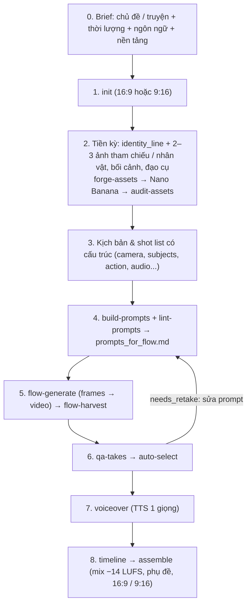

# AI Video Studio — Runbook sản xuất

Tài liệu tham chiếu:
- [prompt_templates.md](./references/prompt_templates.md) — công thức prompt Gemini / Nano Banana / Veo 3.1.
- [universal_director_engine.md](./references/universal_director_engine.md) — tư duy đạo diễn: kể chuyện, chọn chế độ Veo, dựng phim, âm thanh.
- [flow_ui_playbook.md](./references/flow_ui_playbook.md) — thao tác Google Flow tự động (đã kiểm chứng).

Mọi lệnh: `python scripts/studio_helper.py <lệnh> --project <slug>` (xem `--help`). Cấu hình máy/model/credit: `studio_config.json`.



---

## 0–1. Brief & khởi tạo

```powershell
python scripts/studio_helper.py plan --duration 300 --lang en --avg-shot 5
python scripts/studio_helper.py init --name "Ten du an" --duration 60 --lang vi --aspect 9:16 --style "2D flat cartoon, bold clean outlines" --audio voiceover_external
```
- `--avg-shot`: độ dài trung bình một shot **sau dựng** (phim tài liệu ~4–6s, video ngắn ~2–4s). Số clip cần tạo = thời lượng / avg-shot.
- Video ngắn (TikTok/Shorts/Reels) → `--aspect 9:16` ngay từ đầu.

## 2. Tiền kỳ — khóa danh tính

```powershell
python scripts/studio_helper.py forge-assets --project <slug> --char-name "Rex" --char-type creature --char-desc "a massive adult T. rex with dark charcoal scales, ochre underbelly, amber eyes and scaly lips covering its teeth" --env-name "Hell Creek dawn" --env-desc "misty redwood floodplain with ferns" --props "rib bone@60 cm" --apply-to-manifest
python scripts/studio_helper.py audit-assets --project <slug>
```
- Tạo từng ảnh trong `reference_prompts` bằng **Nano Banana Pro**, lưu đúng `path`. Bối cảnh dùng Nano Banana 2.
- Đặt `short_name` cho nhân vật (vd. "Rex") để hành động viết "Rex walks…".
- `audit-assets` phải PASS (có `identity_line` + ảnh tham chiếu trên đĩa) trước khi tạo video.

## 3. Shot list có cấu trúc

Mỗi shot trong manifest:

```json
{
  "shot_id": "shot_03", "order": 3, "scene_id": "scene_02",
  "camera": "Extreme close-up on the head, 85mm macro lens, very slow push-in",
  "subjects": ["CHAR_TREX"], "environment": "ENV_HELL_CREEK_DAWN",
  "action": "Rex turns its head toward camera as its amber pupils narrow",
  "setting": "", "lighting": "warm golden rim light",
  "audio": {"mode": "voiceover_external", "line": "Forget movie myths...", "sfx": "slow nasal breathing"},
  "generation_mode": "first_frame", "first_frame_path": "assets/frames/S03_START.png",
  "negative_prompt": "", "transition_to_next": "INTRA_SCENE_CONTINUE", "transition_out": "cut"
}
```
- `audio.mode`: `sfx_only` | `voiceover_external` | `veo_dialogue` (nhép miệng, có `speaker`, `delivery`) | `veo_narration` (không khuyến nghị).
- Shot nối tiếp cùng cảnh: shot A đặt `transition_to_next: "INTRA_SCENE_CONTINUE"`, shot B `generation_mode: "extend"` + `extends: "<shot A>"`. Khi tải từ Flow, chỉ tải **đoạn mở rộng**.
- `crop_focus_x` (0–1): vị trí chủ thể khi phải crop 16:9 → 9:16.
- `transition_out: "dissolve"` chỉ khi có lý do kể chuyện.

## 3b. Nhịp truyện (beat) & cổng duyệt storyboard

- Kịch bản viết theo **beat**, không theo câu: `manifest.beats = [{beat_id, order, purpose, narration, j_cut_sec?}]`, mỗi shot có `beat`.
  Mỗi beat 2–3 shot (toàn / cận / phản ứng); chương theo hook → leo thang → cao trào → câu hỏi treo.
- Lời dẫn 1 file/beat (`voiceover`), chạy xuyên các shot của beat (L-cut); `j_cut_sec` cho lời beat mới vào trước hình.
  `auto-select` chia thời lượng hình theo lời của beat.
- **Bắt buộc trước khi tạo video:** `flow-generate --kind frames` → chọn frame → `storyboard` → người dùng xem
  `output/storyboard.html` → `storyboard-approve`. Tạo video bị chặn nếu chưa duyệt hoặc sửa sau khi duyệt.

## 4. Prompt

```powershell
python scripts/studio_helper.py build-prompts --project <slug>
python scripts/studio_helper.py lint-prompts --project <slug> --strict
```
- `build-prompts` ghép prompt + định tuyến model (Quality/Fast theo độ khó) + xuất `prompts_for_flow.md` (chế độ, input cần đính kèm, prompt, negative prompt).
- Sửa đến khi `lint-prompts` không còn `error`; xử lý `warn` hoặc ghi rõ lý do giữ lại.
- Dự án cũ: `migrate` rồi `lint-prompts --fix-legacy`.

## 5. Tạo trên Flow (tự động)

Agent tự thao tác Flow bằng module `flow.py` — chi tiết: [flow_ui_playbook.md](./references/flow_ui_playbook.md).
```powershell
python scripts/studio_helper.py flow-generate --project <slug> --kind frames --count 2 --dry-run   # kiểm tra trước
python scripts/studio_helper.py flow-generate --project <slug> --kind frames --count 2
python scripts/studio_helper.py flow-harvest  --project <slug> --kind image --wait
python scripts/studio_helper.py flow-generate --project <slug> --kind video --count 2 --max-credits 2000
python scripts/studio_helper.py flow-harvest  --project <slug> --kind video --wait
# sau auto-select:
python scripts/studio_helper.py flow-upscale  --project <slug>          # 1080p cho take đã chọn
```
- Mỗi clip thu về được đăng ký take kèm nguồn gốc (prompt, input + hash, model); clip trùng tự bỏ qua.
- Thủ công khi cần: `register-clip`, `select-take`, `download-batch`.

## 6. QA từng take & tự chọn

```powershell
python scripts/studio_helper.py qa-takes        --project <slug>
python scripts/studio_helper.py qa-takes-submit --project <slug>
python scripts/studio_helper.py auto-select     --project <slug>
```
- `qa-takes`: QA kỹ thuật + contact sheet 8 frame có mốc giờ cho TỪNG take. Người chấm theo `--reviewer` (agent / api / manual).
  Agent: xem `assets/qa/takes/<shot>_takeNN.jpg` + ảnh tham chiếu, trả JSON theo checklist trong file `.md` cạnh đó
  (điểm danh tính/bám prompt/thẩm mỹ + **defects có t_from/t_to và severity major|minor**), ghi vào `.json`.
- Tiêu chí riêng dự án: `manifest.qa_rubric` (vd. `mouth_closed`, `no_smoke_breath`) — cộng thêm vào tiêu chí mặc định.
- `auto-select`: loại take lỗi kỹ thuật; tìm đoạn sạch dài nhất tránh lỗi major; đủ dài cho lời dẫn
  (`vo_offset + lời dẫn + post-roll`) hoặc `preferred_shot_sec`; chấm điểm, chọn take, tự đặt `edit_in/edit_out`.
  Không take nào đạt → `status = needs_retake` + `retake_reasons` → sửa prompt theo `notes` → `flow-generate --retakes`.
- Khóa lựa chọn tay: `lock_take: true` / `lock_edit: true` trên shot.
- QA cấp shot (cũ) vẫn dùng được: `qa`, `qa-vision`, `approve`.

## 6b. Giọng nói cố định

- Nhân vật: `"voice": "Alnilam"`; dự án: `"narrator_voice": "Charon"` (bộ giọng chung của Flow và Gemini TTS). `forge-assets --char-voice <tên>` ghi sẵn.
- Shot có lời trong Veo (`veo_dialogue` / `veo_narration`): trên Flow mở **Giọng nói → <tên> → Thêm vào câu lệnh**. Lint báo `NO_FIXED_VOICE` nếu chưa đặt giọng.
- So giọng giữa các take: `compare-voices clip1.mp4 clip2.mp4 …` → chênh cao độ (%) + độ giống màu giọng. Chỉ bắt khác biệt rõ; kết luận cuối bằng tai.

## 7. Lời dẫn

```powershell
python scripts/studio_helper.py voiceover --project <slug>
```
- Có `google-genai` + `GEMINI_API_KEY`: tự tạo `assets/audio/vo/<shot>.wav` bằng Gemini TTS (giọng `narrator_voice` / `tts.voice`, chỉ đạo đọc ở `voiceover_direction`).
- Không có: xuất `voiceover_script.md`; thu âm/TTS ngoài, đặt WAV đúng tên rồi chạy lại lệnh để liên kết.

## 8. Dựng & xuất bản

```powershell
python scripts/studio_helper.py timeline --project <slug>
python scripts/studio_helper.py score --project <slug>        # nhạc tự tổng hợp theo beat (chạy lại khi timeline đổi độ dài)
python scripts/studio_helper.py thumbnail --project <slug> --title "..." --subtitle "..." [--shot shot_05]
python scripts/studio_helper.py assemble --project <slug> --format both --music "assets/audio/music/score.mp3"
python scripts/studio_helper.py assemble --project <slug> --format vertical --burn-subs
```
- Độ dài shot: `edit_in/edit_out` thủ công > độ dài lời dẫn > vùng thoại ước lượng > cả clip. Audio và video luôn cắt cùng cửa sổ (không lệch tiếng).
- Mix: âm Veo (giảm khi có lời dẫn) + lời dẫn + nhạc (tự hạ khi có lời) → loudnorm −14 LUFS / −1.5 dBTP.
- Đầu ra: `output/final_video.mp4` (16:9), `output/final_video_9x16.mp4`, `subtitles*.srt` (đăng kèm YouTube), `timeline.json`.
- Chỉnh màu đồng bộ: `--lut grade.cube`.
- Đọc `edit_notes` trong kết quả và báo User (điểm nối lệch, lời dẫn dài hơn hình...).
