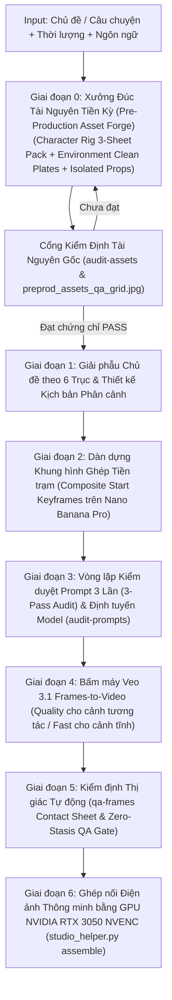

# AI Video Studio — Universal Autonomous Production Runbook

Skill này hướng dẫn Agent tự động hóa toàn bộ quy trình sản xuất phim & video AI cho **bất kỳ chủ đề, lĩnh vực hay phong cách nào** trên `https://gemini.google.com/` và `https://flow.google.com/` kết hợp bộ công cụ kiểm định kỹ thuật `scripts/studio_helper.py`.

Tài liệu tham chiếu cốt lõi:
- [universal_director_engine.md](./references/universal_director_engine.md): Kiến trúc Đạo diễn Động 6 Chiều (Zero-Hardcode Architecture) & 3 Kỹ thuật Triệt tiêu 100% "Sạn" AI.
- [prompt_templates.md](./references/prompt_templates.md): Bộ Meta-Prompt Động Đa Chiều dùng trên Gemini Ultra.

---

## Quy Trình Sản Xuất 7 Giai Đoạn Chuẩn Studio (Tier-1 Asset-First Pipeline)



---

## Quy Trình Chi Tiết & Các Lệnh Kiểm Định Chuẩn Studio

### Giai Đoạn 0: Xưởng Đúc Tài Nguyên Tiền Kỳ (Pre-Production Asset Forge)
*Trước khi viết kịch bản chi tiết và trước khi tạo bất kỳ video nào, bắt buộc phải đúc và khóa toàn bộ tài nguyên gốc:*
1. **Bộ 3 Bản Thiết Kế Model Cho Mỗi Nhân Vật Chính (`Character Rig Pack` trên Nano Banana Pro)**:
   - **Bản vẽ 1 — `Turnaround 5 Góc (Orthographic 360°)`**: Khóa hình khối trước, sau, trái, phải, trên xuống trên 1 tấm 16:9 duy nhất. **Quy tắc Bắt buộc (Zero-Prop Law)**: Hai tay/chi hoàn toàn trống rỗng (`empty hands, natural neutral posture, no held objects`), không gắn sẵn vũ khí hay đồ vật rời.
   - **Bản vẽ 2 — `Articulation, Expression & Hand/Limb Rig`**: Khóa trạng thái khẩu hình/hàm (khép tự nhiên vs. mở nói/gầm) và bàn tay (mở rỗng chuẩn 5 ngón vs. co ngón cầm nắm đồ vật).
   - **Bản vẽ 3 — `Scale & Anatomy Reference Sheet`**: Khóa tỷ lệ giải phẫu 1:1 so với vật chuẩn trên cùng một mặt phẳng tiếp đất.
2. **Bối Cảnh Sạch Không Người (`Environment Clean Plates` trên Nano Banana 2.1)**:
   - Tạo trước các góc bối cảnh sạch không có bóng người hay sinh vật (`empty environment, no people, no creatures`) để làm hệ quy chiếu ánh sáng và không gian nền không đổi.
3. **Thư Viện Đạo Cụ Tách Rời (`Isolated Props Library` trên Nano Banana Pro)**:
   - Mọi đồ vật nhân vật sẽ cầm, nhặt, ném hoặc cắn xé phải được tạo riêng trên nền studio trung tính ở 3 góc nhìn, ghi rõ kích thước chuẩn vật lý (cm/m).
4. **Cổng Kiểm Định Tài Nguyên Tiền Kỳ (`python scripts/studio_helper.py audit-assets`)**:
   - Tự động quét kiểm tra toàn bộ Rig nhân vật, Bối cảnh sạch, Đạo cụ và xuất lưới ảnh đối chiếu `assets/qa/preprod_assets_qa_grid.jpg`. Chỉ khi đạt `PASS` (`ready_for_keyframe_staging: true`) mới được chuyển sang dàn dựng kịch bản và cảnh quay!
   - Tự động sinh bộ prompt mẫu cho tài nguyên mới:
     ```powershell
     python scripts/studio_helper.py forge-assets --project "projects/<slug>" --char-name "Tên Char" --char-type human|creature|robot --char-desc "Mô tả chi tiết" --props "đạo cụ 1, đạo cụ 2" --env-name "Tên Bối cảnh" --env-desc "Mô tả bối cảnh" --apply-to-manifest
     ```

### Giai Đoạn 1 & 2: Kịch Bản & Dàn Dựng Khung Hình Ghép Tiền Trạm (`Composite Keyframe Staging`)
- Ghép **[Char Rig] + [Environment Plate] + [Prop Sheet]** thành các **Start Keyframes** tại giây `t = 0.0s`.
- Khóa toàn bộ tư thế tiếp xúc va chạm/ôm/cắn xé bằng kỹ thuật **Tiếp xúc khuất khối chuẩn BBC (`Closed-Jaw / Occluded Contact`)** ở dạng ảnh tĩnh 8K trước khi chuyển động.

### Giai Đoạn 3: Vòng Lặp Kiểm Duyệt Prompt 3 Lần & Định Tuyến Model (`audit-prompts`)
3. **Định Tuyến Model Linh Hoạt Theo Độ Khó & Tối Ưu Ngân Sách 85,000 Tokens (`Smart Model & Credit Router`)**:
   - **Tạo Ảnh (`Nano Banana Pro` vs. `Nano Banana 2.1`)**:
     * Dùng **`Nano Banana Pro`** cho **Bộ 3 Bản Thiết Kế Model Nhân Vật** (`Turnaround 5 Góc`, `Articulation Tay/Hàm`, `Scale Sheet`) và các **Composite Keyframe** có nhiều nhân vật tương tác hoặc cầm nắm đạo cụ phức tạp.
     * Dùng **`Nano Banana 2.1`** cho các bức ảnh bối cảnh môi trường tĩnh (`Environment Plates`) hoặc cảnh đơn giản để tối ưu tốc độ.
   - **Tạo Video (`Veo 3.1 - Quality [100 tokens]` vs. `Veo 3.1 - Fast [10 tokens]`)**:
     * Dùng **`Veo 3.1 - Quality` (`100 tokens/clip`)** cho các cảnh có **Độ phức tạp cao (`Complexity Score >= 4`)**: cảnh có tương tác vật lý cơ sinh học (cắn xé, va chạm, cầm/thả đồ vật, cử động ngón tay phức tạp, té nước/bùn), cảnh nhiều nhân vật tương tác (`Two-Shot / Combat`), hoặc cảnh Mở đầu (`Hook`) / Cao trào (`Climax`).
     * Dùng **`Veo 3.1 - Fast` (`10 tokens/clip`)** cho các cảnh **Đơn giản (`Complexity Score < 4`)**: cảnh toàn môi trường thiên nhiên, cảnh 1 nhân vật đi bộ/thở chậm, cảnh chuyển máy quay tĩnh đơn giản mà AI nào cũng làm tốt — tiết kiệm gấp 10 lần token (10 vs 100) trên các cảnh dễ để dồn ngân sách 85,000 tokens (+50 tokens/ngày) cho những cảnh phức tạp nhất!
4. **Ngữ Pháp Dựng Phim Chuẩn Điện Ảnh, Vật Lý Tiếp Xúc Đóng Khớp BBC & Gộp Shot Cùng Cảnh (`v10.0 BBC Biomechanical Contact Physics + True Single-Take Intra-Scene Chaining + Zero-Morphing Engine`)**:
   - **Giao Thức Tiếp Xúc Đóng Khớp & Cấm Vật Thể Lơ Lửng (`v10.0 Closed-Jaw Occluded Contact & Anti-Floating-Prop Law`)**:
     * **CẤM TUYỆT ĐỐI** mô tả các mảnh xương rời (`loose rib bone`, `ivory stick bone`) bay lơ lửng trong miệng đang mở (gây lỗi khúc xương cao su lơ lửng lúc `1:00`), và **CẤM dùng từ khóa `exposed ribcage` / `skeleton`** khi mô tả xác con mồi vừa săn (tránh lỗi AI vẽ bộ xương khô bảo tàng ở cảnh trước rồi mọc lại da thịt ở cảnh sau như `0:55 -> 1:00`!).
     * **Kỹ thuật Đạo diễn CGI chuẩn BBC Prehistoric Planet (`Closed-Jaw Occluded Clamp + Adductor Muscle Tension`)**: Mọi tương tác cắn/xé/va chạm nặng bắt buộc sử dụng **Tiếp Xúc Khuất Khối & Căng Cơ Giải Phẫu** — hàm răng khép chặt ghim sâu vào khối cơ thể nguyên vẹn (có da dày, đúng tỷ lệ 1:1 với kẻ săn mồi) ở tiền cảnh thấp, truyền tải lực 6 tấn qua **độ phồng căng của cơ hàm (`jaw adductor muscles`), cơ cổ vặn xoắn, rung chấn máy quay (`camera shake`) và âm thanh xương gãy bên trong (`internal acoustic bone crunch SFX`)**.
   - **Luật Bảo Toàn Thực Thể & Chống Mọc Vật Thể Từ Hư Không (`Entity Conservation & Anti-Pop-In Law`)**:
     * Mọi thực thể phụ trong `veo_prompt` bắt buộc phải **có mặt sẵn trong `Start Frame` ngay từ `t = 0.0s`** hoặc phải được lệnh đi vào từ ngoài mép biên khung hình (`"entering smoothly from beyond the outer frame edge, never spawning or materializing mid-air"`).
   - **Luật Gộp 2–3 Shot Cùng Cảnh Thành 1 Cú Máy Đơn (`v10.0 True Single-Take Intra-Scene Protocol`) & Cấm Gắn `End Frame` Gây Biến Hình**:
     * **CẤM dùng ảnh tĩnh vẽ sẵn (`K_mid` hoặc `K_end` khác góc/trạng thái) làm `End Frame`**: Mọi shot đều để `End Frame = EMPTY` để không bao giờ bị biến hình từ Cận cảnh ra Toàn cảnh (`0:49–0:54`), không bị lật ngược 180° (`0:55–1:00`), và không bị đứng hình cuối cảnh.
     * Cắt `Shot A` ngay tại `t_cut_A = speech_end_sec + 0.08s`, trích xuất chính xác `F_exact = Shot_A[t_cut_A]` làm `Start Frame` cho `Shot B`, và ghép **`0.00s Zero-Dissolve Single-Take Stitch`** (không dùng `xfade`, giữ kênh Video `Shot B` từ `0.042s` và chỉ cắt khoảng lặng trên kênh Audio).
5. **Tăng Tốc Phần Cứng Đa Luồng Trên Máy User (`12-Thread Ryzen 5 5600H` + `GPU NVIDIA RTX 3050 NVENC`)**:
   - Tải toàn bộ file song song 12 luồng:
     ```powershell
     python scripts/studio_helper.py download-batch --project "projects/<slug>" --urls-json "urls.json"
     ```
   - Trích xuất frame đang cử động mượt nhất quanh thời điểm kết thúc thoại để nối cảnh:
     ```powershell
     python scripts/studio_helper.py extract-active-frame --clip "projects/<slug>/assets/clips/shot_05.mp4" --out "projects/<slug>/assets/frames/K_05_active.png"
     ```
   - Trích xuất lưới ảnh kiểm định thị giác song song 12 luồng (chỉ mất `~1 giây`):
     ```powershell
     python scripts/studio_helper.py qa-frames --project "projects/<slug>"
     ```
   - Ghép nối Điện Ảnh Thông Minh v10.0 (`True Single-Take 0.00s Stitch + Smart Inter-Scene xfade`) bằng **GPU NVIDIA GeForce RTX 3050 (`h264_nvenc`)**:
     ```powershell
     python scripts/studio_helper.py assemble --project "projects/<slug>"
     ```


