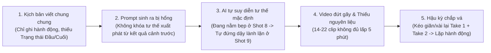
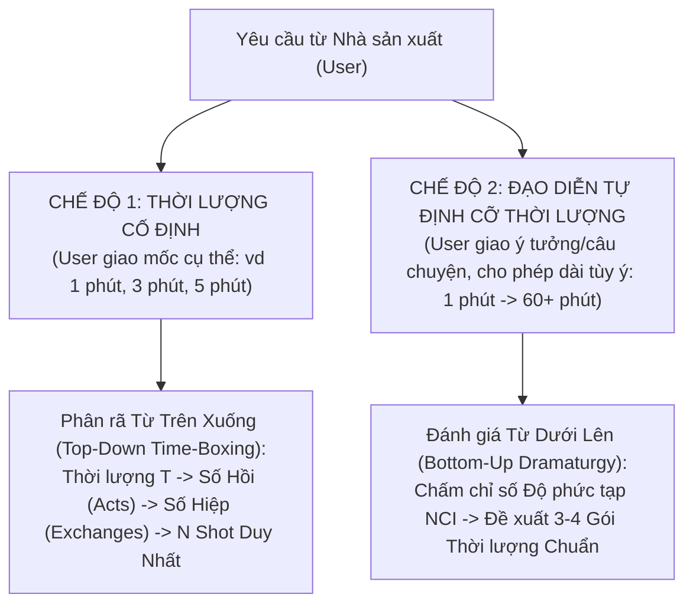

# TIÊU CHUẨN ĐẠO DIỄN & BIÊN ĐẠO ĐIỆN ẢNH TOP 0.1% THẾ GIỚI (WORLD-CLASS 0.1% DIRECTOR & CHOREOGRAPHY STANDARD)

> **Tuyên ngôn Cốt lõi (The Iron Law of Pre-Production):**
> **Mọi giây thời lượng trên màn ảnh phải được sinh ra từ NỘI DUNG KỊCH BẢN & BIÊN ĐẠO TIỀN KỲ, tuyệt đối không sinh ra từ việc cắt nhỏ, lặp lại hay kéo giãn clip cũ ở hậu kỳ.**
> Khi một bộ phim AI bị đứt mạch, nhảy vị trí, lặp cảnh hoặc AI hiểu sai ý đồ tạo ra video lỗi, **95% nguyên nhân gốc rễ nằm ở Tài liệu Đạo diễn & Kịch bản Phân cảnh (`Director Bible & Shot Choreography`) chưa đạt độ chi tiết Cơ học Nhân quả (Causal Finite-State Machine)** — khiến bộ biên dịch Prompt và mô hình Video (Veo 3.1) phải "tự đoán" trạng thái đầu/cuối của từng cảnh.

Tài liệu này đúc kết bộ quy chuẩn của **Top 0.1% Đạo diễn, Chỉ đạo Võ thuật/Hành động, Giám sát Pre-vis & Showrunner xuất sắc nhất thế giới**:
- **Chỉ đạo Hành động & Võ thuật (0.1% Action Choreography):** Yuen Woo-ping (*The Matrix*, *Ngọa Hổ Tàng Long*), Chad Stahelski & 87Eleven (*John Wick 1–4*), Gareth Evans (*The Raid 1 & 2*).
- **Đạo diễn Đại cảnh Sinh vật & Pre-vis Khối lượng lớn (0.1% Creature & Blockbuster Pre-vis):** Steven Spielberg & Phil Tippett / ILM (*Jurassic Park*, *Jurassic World*), Peter Jackson & Weta Digital (*King Kong 2005* — trận Kong đấu 3 V-Rex dài 7 phút liên tục), George Miller (*Mad Max: Fury Road*), Genndy Tartakovsky (*Primal*).
- **Kiến trúc sư Kịch bản & Nhịp độ Điện ảnh (0.1% Showrunners & Dramaturgs):** Christopher Nolan, Denis Villeneuve, Vince Gilligan (*Breaking Bad*), Craig Mazin (*Chernobyl*, *The Last of Us*), Robert McKee (*Story*).

---

## PHẦN 1: CHẨN ĐOÁN GỐC RỄ — VÌ SAO NỘI DUNG SƠ SÀI KHIẾN AI ĐỌC NHẦM VÀ TẠO VIDEO SAI?

### 1.1. Chuỗi Domino Lỗi từ Nội dung đến Video (`The Garbage-In Hallucination Chain`)
Mô hình tạo video AI (như Veo 3.1) **không có bộ nhớ dài hạn giữa các lần bấm tạo clip**. Mỗi Shot 8 giây là một vũ trụ độc lập đối với AI.

### 1.2. 4 Căn bệnh Kinh điển của Kịch bản khiến AI "Đọc Nhầm"
1. **Hội chứng "Mất Trí Nhớ Trạng Thái" (`State Amnesia between Shots`):**
   - *Ví dụ lỗi:* Shot 08 mô tả *"Rex quật ngã Vasto xuống bùn"*. Shot 09 viết *"Vasto tung cú quất đuôi vào mặt Rex"*.
   - *Vì sao AI làm sai:* Khi đọc Shot 09, AI không hề biết ở cuối Shot 08 Vasto đang **nằm nghiêng dưới bùn**. AI lập tức vẽ Vasto đang đứng thẳng hai chân bình thường để quất đuôi -> Khi ghép Shot 08 với Shot 09, khán giả thấy Vasto "dịch chuyển tức thời" từ nằm bẹp sang đứng thẳng!
   - *Cách 0.1% Đạo diễn viết:* Shot 09 bắt buộc phải mở đầu bằng `entry_state`: *"Vẫn đang nằm nghiêng bên sườn phải dưới lớp bùn sâu sau cú quật của Rex, Vasto lấy điểm tựa từ bả vai, bất ngờ xoay hông quất ngược khúc đuôi vảy sừng từ dưới thấp văng ngược lên trúng hàm Rex (`low-to-high sweeping tail counter-strike from prone position`)"*, giúp Vasto vừa đánh lùi Rex vừa có thời gian chống chân đứng dậy ở cuối Shot 09 (`exit_state: cả hai lùi ra 4m, đứng gầm gừ`).
2. **Hội chứng "Văn Kể Chuyện Trừu Tượng" (`Abstract Narrative Prose vs. Kinematic Verbs`):**
   - *Ví dụ lỗi:* *"Vasto nhận ra không thể đọ sức mạnh trực diện nên quyết định dùng sự linh hoạt để phản công."*
   - *Vì sao AI làm sai:* Máy quay không chụp được chữ *"nhận ra"* hay *"quyết định"*. AI sẽ tạo ra một con khủng long đứng đơ tại chỗ há miệng vô nghĩa.
   - *Cách 0.1% Đạo diễn viết:* Mọi ý đồ tâm lý phải dịch 100% sang **Động từ Cơ sinh học (`Biomechanical Verbs`)**: *"Đôi đồng tử vàng của Vasto co rút lại; nó hạ thấp trọng tâm sát mặt nước, lách qua dưới cổ Rex với tốc độ cực nhanh rồi bấu móng vuốt chân sau vào bắp đùi đối thủ."*
3. **Hội chứng "Thiếu Ngân sách Hành động cho Thời lượng" (`Action Starvation`):**
   - *Ví dụ lỗi:* Muốn làm phim 5 phút (`300 giây`) nhưng kịch bản chỉ có 14 hoặc 22 ý hành động.
   - *Hệ quả:* Dù có chia đôi mỗi clip hay lấy cả Take 1 lẫn Take 2 ghép vào, người xem vẫn nhận ra chỉ có bấy nhiêu đòn đánh lặp đi lặp lại trong cùng một vũng nước suốt 5 phút.
4. **Hội chứng "Đấu Trường Đóng Băng & Máu Tự Lành" (`Static Arena & Resetting Damage`):**
   - Đánh nhau 5 phút nhưng bối cảnh từ phút thứ 1 đến phút thứ 5 vẫn y hệt một góc rừng; vết thương, bùn đất bám trên da ở cảnh trước sang cảnh sau biến mất sạch sẽ.

---

## PHẦN 2: KIẾN TRÚC THỜI LƯỢNG KÉP (DUAL-MODE RUNTIME ARCHITECTURE)

Đạo diễn Top 0.1% luôn làm việc theo **2 Chế độ Thời lượng** tùy theo yêu cầu của Nhà sản xuất (User):

### 2.1. Định luật Bất biến về Mật độ Shot (`The 1:1 Unique Shot Density Law`)
Trong điện ảnh chuyên nghiệp (Hollywood / Weta / ILM / Netflix):
- **1 Cú cắt trên phim (`Edited Cut`) = 1 Biến cố Vi mô Mới (`1 Unique Micro-Event`) = 1 Shot Độc lập trong Kịch bản.**
- **Cấm tuyệt đối:** Không bao giờ lấy Take 1 ghép nối tiếp Take 2 của cùng một câu lệnh (`veo_prompt`) để kéo dài thời gian.
- **Công thức tính Số Shot Duy Nhất Bắt Buộc ($N_{\text{shots}}$):**
  $$N_{\text{shots}} = \left\lceil \frac{T_{\text{target}}}{\text{ASL}_{\text{genre}}} \right\rceil$$
  Trong đó $\text{ASL}_{\text{genre}}$ (*Average Shot Length* — độ dài trung bình 1 shot sau khi cắt bỏ đầu/đuôi thừa từ clip Veo 8s):
  - **Hành động / Đại chiến / Võ thuật (`action_blockbuster`, `wuxia_xianxia`):** $\text{ASL} = 3.5\text{s} - 4.2\text{s}$ (tối ưu `4.0s/shot`).
  - **Kinh dị / Khoa học viễn tưởng / Anime (`horror_thriller`, `cyberpunk_scifi`, `anime_2d_3d`):** $\text{ASL} = 4.0\text{s} - 4.5\text{s}$.
  - **Tài liệu Thiên nhiên / Sử thi / Tâm lý (`nature_documentary`, `historical_epic`, `romance_kdrama`):** $\text{ASL} = 4.5\text{s} - 5.5\text{s}$.

#### Bảng Định mức Biên đạo theo Thời lượng (Chuẩn Hành động / Đại chiến $\text{ASL} \approx 4.0\text{s}$):

| Thời lượng Mục tiêu ($T$) | Số Hồi (`Acts`) | Số Đấu trường / Bối cảnh (`Arenas`) | Số Hiệp Giao tranh (`Exchanges`) | Số Bước ngoặt Lật kèo (`Reversals`) | **Số Shot Duy nhất Bắt buộc ($N_{\text{shots}}$)** |
| :--- | :---: | :---: | :---: | :---: | :---: |
| **1 Phút (`60s` — Short/Reels)** | 3 hồi ngắn (20s/hồi) | 1 đấu trường (2 tầng địa hình) | 3 hiệp | 1–2 lần lật kèo | **15 – 18 shots** |
| **3 Phút (`180s` — Set-Piece Chuẩn)** | 3 hồi (60s/hồi) | 3 đấu trường liên hoàn | 9 hiệp | 3 lần lật kèo | **42 – 48 shots** |
| **5 Phút (`300s` — Đại chiến IMAX)** | **5 hồi (60s/hồi)** | **5 đấu trường liên hoàn** | **15 hiệp** | **5 lần lật kèo** | **70 – 78 shots** |
| **10 Phút (`600s` — Phim Ngắn/Tập)** | 5 hồi (120s/hồi) | 6–8 bối cảnh + rượt đuổi | 28–30 hiệp/cảnh | 7–8 lần lật kèo | **140 – 160 shots** |
| **30 Phút (`1800s` — Tập Đặc biệt)** | 4 chương lớn | 12–15 bối cảnh đa sinh cảnh | 80+ phân đoạn | 15+ bước ngoặt | **420 – 480 shots** |
| **60 Phút (`3600s` — Phim Điện ảnh)** | 3 Hồi / 8 Sequences | 25+ bối cảnh (Thế giới hoàn chỉnh) | 160+ phân đoạn | Chuỗi nhân quả đa tuyến | **800 – 950 shots** |

---

### 2.2. CHẾ ĐỘ 1: Khi User giao Thời lượng Cố định (Ví dụ: *"Làm trận đánh nhau 5 phút / 300 giây"*)

Khi có khung thời gian cố định $T = 300\text{s}$, Đạo diễn Top 0.1% (như Peter Jackson biên đạo trận *Kong vs. 3 V-Rexes* hay Gareth Evans biên đạo *The Raid*) không bao giờ viết tràn lan mà chia theo **Cấu trúc Đồng hồ Thụy Sĩ 3 Tầng (`Macro Act -> Meso Exchange -> Micro Cell`)**:

#### Tầng 1 — 5 Hồi Địa hình & Cán cân Sức mạnh (`5 Acts × 60s = 300s`):
Một trận đánh 5 phút muốn khán giả không rời mắt **bắt buộc phải dịch chuyển qua 5 tiểu đấu trường (`Sub-Arenas`)** với địa hình, vũ khí tự nhiên và mức độ thương tích leo thang:
- **HỒI I (`0:00 – 1:00` | 15 Shots | `Arena 1: Bờ Suối Ngập Nước & Ranh Giới Lãnh Thổ`):**
  - *Mục tiêu Kịch tính:* Thiết lập quy mô khổng lồ, lý do xung đột (tranh giành lãnh thổ/con mồi) và cú va chạm mở màn.
  - *Diễn biến:* Rung chấn bước chân cymatics -> Phát hiện đối thủ qua màn sương -> Gầm uy hiếp -> Lao vào đâm sầm giữa lòng suối -> Thủy chiến đợt 1 (Cân sức 50/50).
- **HỒI II (`1:00 – 2:00` | 15 Shots | `Arena 2: Rừng Cổ Thụ Redwood Mục Nát`):**
  - *Mục tiêu Kịch tính:* Tốc độ & Sự linh hoạt (Vasto) áp đảo Sức nặng (Rex).
  - *Diễn biến:* Cú va chạm đẩy cả hai văng lên bờ rừng cổ thụ -> Vasto lợi dụng thân cây lớn để ẩn nấp, lách sườn cắn trộm vào bắp đùi/sườn Rex -> Thân cây cổ thụ gãy đổ chắn ngang -> **Bước ngoặt 1 (`Reversal 1`):** Rex bị cây đổ kẹp chân, Vasto nhảy lên lưng cào rách bả vai Rex (Vasto chiếm ưu thế 70/30).
- **HỒI III (`2:00 – 3:00` | 15 Shots | `Arena 3: Đầm Bùn Đá Bazan & Hố Lầy`):**
  - *Mục tiêu Kịch tính:* Sức mạnh cơ học thuần túy & Lực cắn nghiền xương của Rex phản kích.
  - *Diễn biến:* Rex gầm vang, hất tung thân cây mục, quật đầu vào ngực Vasto đẩy cả hai trượt xuống đầm bùn bazan trơn trượt -> Trong bùn sâu, Vasto mất lợi thế tốc độ chân -> **Bước ngoặt 2 (`Reversal 2`):** Rex ngoạm chặt hàm răng vào cổ Vasto, ghì sập Vasto xuống bùn sâu -> Vasto giãy giụa, dùng vuốt chân sau đạp rách cằm Rex và quất đuôi tạt bùn mù mắt Rex để thoát khỏi cú ghì (Rex chiếm ưu thế 75/25 rồi bị gỡ hòa).
- **HỒI IV (`3:00 – 4:00` | 15 Shots | `Arena 4: Vách Đá Hẻm Núi Sạt Lở`):**
  - *Mục tiêu Kịch tính:* Điểm Đen Tối Nhất (`All Is Lost / Desperation Phase`) — Cả hai đã thấm mệt, thở ra khói trắng, mình đầy bùn và vết máu, phải dùng địa hình hiểm trở.
  - *Diễn biến:* Rex bị bùn che mắt tạm thời, Vasto lùa Rex dồn ra sát mép vách đá hẻm núi đang sạt lở -> **Bước ngoặt 3 (`Reversal 3`):** Đá dưới chân chân phải của Rex vỡ vụn, Rex trượt nửa người xuống mép vực, hàm Vasto lao tới định kết liễu -> Khoảnh khắc sinh tử: Rex nghiêng đầu né cú đớp vào khoảng không, dùng hộp sọ cứng húc ngược từ dưới lên trúng cổ họng Vasto (`Upward Cranial Ram`).
- **HỒI V (`4:00 – 5:00` | 15 Shots | `Arena 5: Đỉnh Vực Thác Nước & Đòn Kết Liễu Đỉnh Cao`):**
  - *Mục tiêu Kịch tính:* Đòn Tất Sát (`Climactic Finisher`) & Dư âm Thống trị (`Apex Aftermath`).
  - *Diễn biến:* Cả hai titan đứng đối diện trong mưa tầm tã, máu hòa nước mưa, hơi thở dồn dập -> Cú lao cuối cùng dồn 100% sinh lực -> **Bước ngoặt 4 (`Finisher`):** Rex chịu một vết cào sâu vào ngực để đổi lấy góc khóa hàm tử thần vào gáy Vasto, xoay người dùng toàn bộ khối lượng 9 tấn quăng Vasto đập vỡ vách đá rơi xuống dòng thác sương mù bên dưới (hoặc buộc Vasto tháo chạy xuống vực) -> Rex đặt chân lên mỏm đá cao nhất, ngửa cổ gầm vang giữa tia chớp và ánh lửa bình minh.

#### Tầng 2 — 15 Hiệp Giao tranh (`15 Tactical Exchanges × 20s`):
Mỗi Hồi 60 giây được chia đúng thành **3 Hiệp (`Exchanges`)**, mỗi hiệp 20 giây giải quyết trọn vẹn 1 câu hỏi vật lý (Ví dụ: *Làm sao thoát khỏi cú khóa cổ? Làm sao dùng thân cây đổ làm vũ khí?*).

#### Tầng 3 — Tế bào Hành động - Phản ứng 5 Shot (`The 5-Shot Action-Reaction Cell` = 20s):
Trong mỗi Hiệp 20 giây, Đạo diễn viết đúng **4 đến 5 Shot Duy Nhất (`~4.0s/shot`)** theo chu kỳ cơ sinh học:
1. **Shot 1 — Lấy đà & Ý đồ (`Telegraph / Setup` — `4.0s`):** Góc trung/rộng hoặc POV thấp, cho thấy sự chuẩn bị cơ bắp, bước chân dồn lực, ánh mắt khóa mục tiêu.
2. **Shot 2 — Phát lực & Va chạm (`Strike / Collision` — `4.0s`):** Góc rộng/3/4 theo chiều sâu (`Z-axis`), hai khối cơ thể lao vào nhau, quán tính truyền lực rõ ràng.
3. **Shot 3 — Đặc tả Điểm Tiếp Xúc (`Visceral Macro Insert` — `3.0s`):** Ống kính 85mm–100mm cận cảnh răng/móng vuốt/vũ khí cắm ngập vào da thịt hoặc bàn chân đạp vỡ đá.
4. **Shot 4 — Hệ quả Vật lý & Ngã/Văng (`Consequence / Recoil` — `4.5s`):** Kẻ trúng đòn bị hất văng, ngã sập xuống bùn/gãy cây, thay đổi hoàn toàn tư thế (`standing` -> `prone/pinned`).
5. **Shot 5 — Phản ứng Sinh tồn & Chuyển thế (`Recovery / Counter-Pivot` — `4.5s`):** Kẻ bị đè dùng địa hình hoặc đòn hiểm thoát ra, thiết lập `exit_state` mở đường cho Hiệp tiếp theo.

---

### 2.3. CHẾ ĐỘ 2: Khi User giao Chủ đề và cho phép Đạo diễn Tự Đánh giá Thời lượng Hợp lý (`1 phút -> 60+ phút`)

Khi Nhà sản xuất nói: *"Tôi có ý tưởng này, bạn tự phân tích và đưa ra thời lượng hợp lý nhất — nếu ý tưởng hay và chi tiết thì dài chục phút hay cả tiếng đều được"*, Đạo diễn Top 0.1% không chọn bừa một con số mà chấm **Chỉ số Độ Phức Tạp Tự Sự (`Narrative Complexity Index — NCI`, thang 5–25 điểm)** trên 5 trục:

1. **Trục 1 — Quy mô Nhân vật & Hệ sinh thái (`Cast & Ecosystem Scale` | 1–5 điểm):**
   - 1đ: 1–2 nhân vật đơn lẻ.
   - 3đ: 2 nhân vật chính + bầy đàn/quần chúng hoặc con non cần bảo vệ.
   - 5đ: Hệ sinh thái đa phe phái (3–5 loài/nhóm nhân vật có mục tiêu chồng chéo).
2. **Trục 2 — Chiều sâu Xung đột & Động cơ (`Conflict & Emotional Stakes` | 1–5 điểm):**
   - 1đ: Đụng độ tình cờ.
   - 3đ: Sinh tồn (bảo vệ ổ trứng/con non, tranh giành nguồn sống cuối cùng trong mùa hạn/núi lửa).
   - 5đ: Bi kịch/Sử thi nhiều giai đoạn (mối thù truyền kiếp, mất mát đầu phim -> rèn luyện/thích nghi -> phục thù).
3. **Trục 3 — Độ rộng Bản đồ & Biến đổi Môi trường (`World & Biome Progression` | 1–5 điểm):**
   - 1đ: 1 căn phòng / 1 vũng nước.
   - 3đ: 3–5 tiểu địa hình liên thông (Suối -> Rừng -> Đầm lầy -> Vách đá -> Vực thác).
   - 5đ: Hành trình xuyên nhiều vùng khí hậu/thời gian (Ngày -> Hoàng hôn -> Bão đêm -> Bình minh lửa núi lửa).
4. **Trục 4 — Kho vũ khí Chiến thuật & Bước ngoặt (`Tactical Arsenal & Reversals` | 1–5 điểm):**
   - Số lượng đòn đánh, bẫy địa hình và bước ngoặt "NHƯNG / VÌ VẬY" không trùng lặp.
5. **Trục 5 — Nhịp thở Điện ảnh & Chiều sâu Khoa học/Tâm lý (`Atmospheric Pacing & Lore` | 1–5 điểm):**
   - Có cần phần mở đầu rình mò căng thẳng (như 10 phút đầu cảnh T-Rex phá rào trong *Jurassic Park*), khoảng lặng băng bó vết thương giữa 2 hiệp đấu, và phần kết lắng đọng không?

#### Khung Đề xuất 4 Cấp độ Thời lượng của Đạo diễn (`Director's 4 Runtime Tiers`):
Sau khi phân tích, Đạo diễn luôn trình bày cho User bảng lựa chọn chiến lược:
- **Gói 1 — `Short / Teaser (60s – 120s | 18–30 Shots)`:** Trích xuất đúng 1 cao trào duy nhất (Climax Clash). Nhịp dồn dập, phù hợp TikTok/Shorts/Reels.
- **Gói 2 — `Theatrical Set-Piece (5 Phút / 300s | 72–80 Shots)`:** Trận đại chiến 5 Hồi – 5 Đấu trường hoàn chỉnh từ lúc phát hiện nhau đến đòn kết liễu. Chuẩn trích đoạn đỉnh cao YouTube (*King Kong vs V-Rexes*, *Rexy vs Indominus*).
- **Gói 3 — `Extended Short Film / Mini-Movie (12 – 15 Phút / 720s–900s | 180–220 Shots)`:** Mở rộng thành câu chuyện 3 Chương hoàn chỉnh:
  - *Chương 1 (3 phút):* Thế giới quan, cuộc săn mồi thường nhật, dấu hiệu kẻ xâm lược bí ẩn (xác con mồi lớn, dấu chân khổng lồ), sự căng thẳng tích tụ trước cơn bão.
  - *Chương 2 (4 phút):* Cuộc chạm trán lần 1 lúc hoàng hôn -> Một bên bị thương nặng phải rút lui vào rừng sâu trong đêm mưa -> Sự rình rập tâm lý trong bóng tối.
  - *Chương 3 (6–8 phút):* Trận quyết chiến sinh tử tại Hẻm núi Lửa / Vực Thác với sự tham gia của hiểm họa tự nhiên (cháy rừng, sạt lở đá) và kết cục bi tráng.
- **Gói 4 — `Feature / Anthology Episode (30 – 60 Phút / 1800s–3600s | 450–900 Shots)`:** Cấu trúc Phim Điện ảnh 8 Sequences (Chuẩn Pixar / Hollywood Feature):
  - Có tuyến truyện chính (A-Plot: Hành trình sinh tồn và bảo vệ lãnh thổ/con non của nhân vật chính) + tuyến truyện đối trọng (B-Plot: Sự trỗi dậy và tàn phá của kẻ săn mồi ngoại lai) + 3 trận giao tranh lớn ở Hồi 1, Midpoint và Hồi 3, mỗi trận mang một ý nghĩa tâm lý và chiến thuật hoàn toàn khác nhau.

---

## PHẦN 3: GIAO THỨC MÁY TRẠNG THÁI HỮU HẠN (FSM CONTINUITY PROTOCOL) — CHỐNG AI ĐỌC NHẦM 100%

Để AI (cả trình biên dịch Prompt lẫn mô hình Veo 3.1 / Nano Banana Pro) **không bao giờ hiểu sai cảnh hoặc vẽ nhảy tư thế**, mỗi Shot trong `project_manifest.json` bắt buộc phải tuân thủ **Phương trình Trạng thái Liên tục (`FSM State Continuity Equation`)**:

$$\boxed{\text{ExitState}(\text{Shot}_{k-1}) \equiv \text{EntryState}(\text{Shot}_{k})}$$

### 3.1. 6 Trường Dữ liệu Đạo diễn Bắt buộc trên mỗi Shot (`Mandatory Director Fields`)

| Trường trong `shot` | Ý nghĩa Điện ảnh & Vật lý | Ví dụ Chuẩn 0.1% |
| :--- | :--- | :--- |
| **`entry_state`** | **Trạng thái Vật lý Đầu Shot (`t = 0.0s`):** Tư thế cơ thể (`standing`, `crouched`, `pinned_on_flank`), vị trí Trái/Phải, khoảng cách, bùn/máu trên người. **Phải khớp 100% với `exit_state` của shot ngay trước đó.** | `"Rex (trái) đang ghì chặt hàm vào cổ Vasto; Vasto (phải) nằm nghiêng sườn phải dưới lớp bùn sâu 40cm, hai chân sau co đạp."` |
| **`causal_link`** | **Liên từ Nhân - Quả (`THEREFORE` / `BUT`):** Cấm dùng *"Và rồi"*. Giải thích vì sao hành động này tất yếu xảy ra từ `entry_state`. | `"BUT: Vasto dùng móng vuốt chân sau móc ngược vào bụng Rex để phá thế khóa hàm."` |
| **`action` + `timeline_phases`** | **Quỹ đạo Cơ sinh học (`t = 0.0s -> 8.0s`):** Chia 3 pha rõ ràng (`0.0-2.5s` Phát lực -> `2.5-5.5s` Va chạm/Tác động -> `5.5-8.0s` Hệ quả). Mỗi chủ thể trong khung hình đều phải có động từ chủ động/phản ứng riêng. | Pha 1: Vasto co chân đạp -> Pha 2: Móng vuốt rạch bụng khiến Rex nhả hàm lùi lại -> Pha 3: Vasto lăn vòng chống chân đứng dậy. |
| **`exit_state`** | **Trạng thái Vật lý Cuối Shot (`t = 8.0s`):** Kết quả vị trí và tư thế sau khi hành động hoàn tất. Dùng để khóa `last_frame_prompt` và truyền thẳng sang `entry_state` của shot kế tiếp. | `"Rex lùi về bên trái 3m, cúi thấp đầu gầm nhẹ; Vasto bên phải vừa chống hai chân đứng dậy, bùn đặc phủ kín sườn phải."` |
| **`arena_stage`** | **Tiểu Đấu trường & Hiểm họa Địa hình:** Đảm bảo bối cảnh biến đổi theo tiến trình trận đánh. | `"ARENA_3_BASALT_MUD_PIT"` |
| **`character_states`** | **Sổ cái Thương tích & Thể lực Lũy tiến (`Progressive Damage Ledger`):** Bùn, nước, vết cào, máu, hơi thở khói phải **tích lũy tăng dần** từ Hồi 1 đến Hồi 5, không bao giờ tự sạch đi. | `{"CHAR_REX": "soaked hide, mud-splattered legs, fresh claw scratch on left shoulder, heavy steam breath"}` |

### 3.2. Quy tắc "Không Nhảy Cóc Tư Thế" (`Zero Posture Teleportation Rule`)
Nếu ở cuối Shot $k$, Nhân vật X đang ở tư thế **Ngã / Nằm / Quỳ / Bị đè (`prone`, `pinned`, `collapsed`, `on its flank`, `on the ground`, `hanging`)**:
- Thì ở đầu Shot $k+1$ (nếu cùng cảnh và có mặt Nhân vật X), `entry_state` / `start_action` **BẮT BUỘC** phải giữ Nhân vật X ở đúng tư thế đang nằm/bị đè đó!
- Muốn Nhân vật X đứng dậy tấn công ở Shot $k+2$, thì chính nội dung của Shot $k+1$ phải là **Cảnh Phá vây / Chống chân đứng dậy (`Recovery / Kip-up / Counter-Push`)**.
- Bộ công cụ `lint-prompts` tự động quét lỗi này qua mã cảnh báo `FSM_POSTURE_DISCONTINUITY`.

---

## PHẦN 4: NGỮ PHÁP MÁY QUAY & DỰNG PHIM HÀNH ĐỘNG TOP 0.1%

### 4.1. Định luật Chọn Ống kính theo Lực Va Chạm (`Lens-to-Impact Matching`)
Tại sao nhiều cảnh cắn/đâm trong video AI trông như "lướt qua người nhau"?
- **Lỗi:** Dùng ống kính góc rộng (`24mm–28mm Wide Shot`) cho cảnh răng cắn ngập vào cổ hoặc lưỡi kiếm đâm qua giáp. Trong khung hình rộng, chiếc răng chỉ chiếm `< 3%` diện tích ảnh -> AI không đủ độ phân giải pixel để vẽ biến dạng da thịt!
- **Chuẩn 0.1% (Spielberg / Gareth Evans):**
  - **Pha Lao vào & Quật ngã (`Full-Body Trajectory & Knockdown`):** Dùng ống kính `24mm–35mm Anamorphic Wide / Medium-Wide`, đặt máy thấp ngang tầm mắt con người (`1.2m Ground-Level`) có tiền cảnh mờ (`Dirty Frame: cành dương xỉ, tảng đá, tia nước bắn`) để tôn kích thước khổng lồ và quỹ đạo văng.
  - **Pha Cắn ngập răng / Vuốt cào / Đòn chí mạng (`Visceral Flesh Compression`):** Bắt buộc cắt vào ống kính **`85mm–100mm Macro Close-Up`** trong `2.5s–3.5s` sao cho bộ hàm/móng vuốt và vùng da thịt bị ép lún chiếm **`> 40%` diện tích khung hình**.

### 4.2. Định luật Tâm điểm Ánh nhìn của George Miller (`Crosshair Framing & Eye-Trace`)
Trong *Mad Max: Fury Road* (giành giải Oscar Dựng phim xuất sắc nhất), George Miller đặt **điểm va chạm chính xác tại giao điểm trung tâm khung hình (hoặc trục 1/3 cố định)** giữa 2 cú cắt liên tiếp:
- Khi cắt từ `Shot A (Wide: Rex lao tới từ trái sang phải)` sang `Shot B (85mm Close-Up: Hàm Rex ngoạm cổ Vasto)`, vị trí cổ Vasto trên màn hình ở cuối Shot A phải nằm cùng tọa độ màn hình với vị trí cú ngoạm ở đầu Shot B -> Mắt khán giả không mất 0.2 giây đi tìm chủ thể, tạo cảm giác cú đớp liền mạch 100%.

### 4.3. Định luật Chậm Trễ Cơ Học 3 Nhịp (`3-Beat Mass Delay Physics`)
Sinh vật nặng 8–10 tấn (hoặc chiến binh mặc giáp nặng) không bao giờ di chuyển như bóng bay:
1. **Nhịp 1 — Dồn trọng lượng (`Weight Shift`):** Bàn chân đạp lún bùn/đá, cơ đùi căng phồng trước khi thân mình nhúc nhích.
2. **Nhịp 2 — Va chạm & Trễ Sóng Xung Kích (`Impact + 0.15s Shockwave Delay`):** Đầu/hàm chạm mục tiêu tại $t_0$ -> $0.15\text{s}$ sau làn sóng chấn động mới truyền qua lớp mỡ/cơ bắp làm văng nước mưa và bùn khỏi lưng đối thủ.
3. **Nhịp 3 — Dư chấn Môi trường (`Environmental Aftermath`):** Cây gãy, đá lở, sóng nước dội vào ống kính máy quay, rung giật máy tự nhiên (`organic handheld camera rattle on impact`).

---

## PHẦN 5: QUY TRÌNH KIỂM DUYỆT KỊCH BẢN TRƯỚC KHI BẤM RENDER (`THE 0.1% PRE-FLIGHT GATE`)

Trước khi chạy `flow-generate` tốn bất kỳ credit nào, Kịch bản Đạo diễn (`project_manifest.json`) phải vượt qua **6 Cổng Kiểm Duyệt Bắt Buộc**:

1. **Cổng 1 — Đủ Số lượng Shot Duy nhất (`Shot Budget Gate`):**
   - Kiểm tra: `len(shots) >= ceil(target_duration_sec / avg_shot_sec)`.
   - Nếu mục tiêu là 5 phút (`300s`), phải có đủ `70–78` shots có nội dung độc lập (hoặc nếu đạo diễn chọn nhịp cắt 4.5s thì tối thiểu `65` shots). Tuyệt đối không dùng 14–22 shots rồi ép hậu kỳ lặp/chia nhỏ để đủ 5 phút.
2. **Cổng 2 — Liên kết Nhân Quả `THEREFORE / BUT` (`Causality Gate`):**
   - Đọc nối tiếp toàn bộ `shot_01` -> `shot_N`: mỗi shot phải có `causal_link` bắt đầu bằng `THEREFORE` hoặc `BUT`.
3. **Cổng 3 — Khớp Khóa Trạng thái Đầu/Cuối (`FSM Continuity Gate`):**
   - Mọi cặp shot cùng cảnh phải thỏa mãn `shot[k-1].exit_state == shot[k].entry_state`. Không có nhân vật nào tự nhiên đổi từ nằm sang đứng hoặc nhảy từ trái sang phải mà không có shot chuyển tiếp.
4. **Cổng 4 — Tiến hóa Đấu trường & Thương tích Lũy tiến (`Arena & Damage Progression Gate`):**
   - Cứ mỗi `60–75 giây` (`12–16 shots`) phải chuyển sang `arena_stage` mới và cập nhật `character_states` (tăng mức độ ướt, bùn, vết xước, nhịp thở).
5. **Cổng 5 — Cân bằng Góc máy Đa chiều (`Camera Coverage Gate`):**
   - Không quá 2 shot liên tiếp dùng cùng một cỡ cảnh phẳng (`flat medium/wide two-shot`). Phải đan xen: `Wide Geography` -> `OTS Depth` -> `85mm Macro Impact` -> `1.2m Ground-Level POV` -> `Reaction ECU`.
6. **Cổng 6 — Kiểm định Tự động bằng Lệnh (`Automated Linter Gate`):**
   - Chạy `python scripts/studio_helper.py lint-prompts --project <slug> --strict` đạt **0 Error, 0 FSM Discontinuity, 0 Underbudgeted Shot Warning**.
